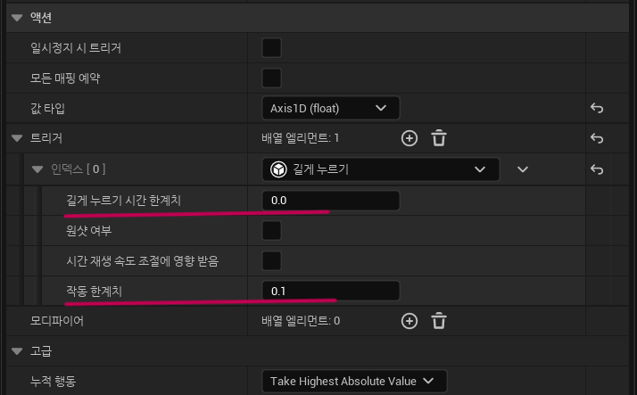

# Enhanced Input

> Enhanced Input은 기존의 Input을 확장하여 더 세밀하고 유연한 입력 처리를 제공합니다.

## 요소
### 1. InputAction
- 특정행동을 나타내는 입력 이벤트를 정의합니다.
- '어떤' 이벤트를 받을지 정의하지 않고, '어떻게' 받을지 정의합니다.
- 대표적으로 아래의 요소를 설정 할 수 있습니다.
    - Action에 대한 값을 어떻게 받을것인가?
        - bool, float, FVector2, FVector3
    - 트리거
    - 모디파이어

### 2. InputMappingContext
- 실제 입력 장치와 InputAction간의 매핑을 정의합니다.
- InputAction과 입력 Key와의 매핑은 1:N의 관계로 정의할 수 있습니다.
- 각 매핑에는 트리거, 모디파이어가 존재할 수 있습니다.
- 이를통해 하나의 매핑 컨텍스트 안에서 여러 액션과 그에 대응하는 입력을 정의할 수 있습니다.
- 개발자는 게임의 다양한 상황에 맞게 여러 매핑 컨텍스트를 생성하고 전환할 수 있습니다, 예를 들어, 차량 조작과 보행 조작에 각각 다른 입력 매핑을 사용할 수 있습니다.   

### 3. Triggers
- 액션을 활성화시키는 조건을 정의합니다.
- 예 : 길게누르기, 다운, 탭, 펄스 등
- 이를 통해 더 복잡하고 다양한 입력 반응을 구현할 수 있습니다.

### 4. Modifiers
- 입력에 추가적인 조건이나 변형을 적용하는 요소입니다.
- 예 : 데드존, 델타시간으로 스케일링, 부정(입력 축 반전) 등
- 이는 입력이 언제 게임 액션으로 변환될지 세밀하게 제어할 수 있게 해줍니다.

## 설정

#### 

## C++ 에서는?

#### 

## 주의사항
#### MouseDrag + 길게누르기
- 길게누르기 시간 한계치, 작동 한계치가 너무 클 경우 이벤트가 발생하지 않는 이슈가 있음.
    