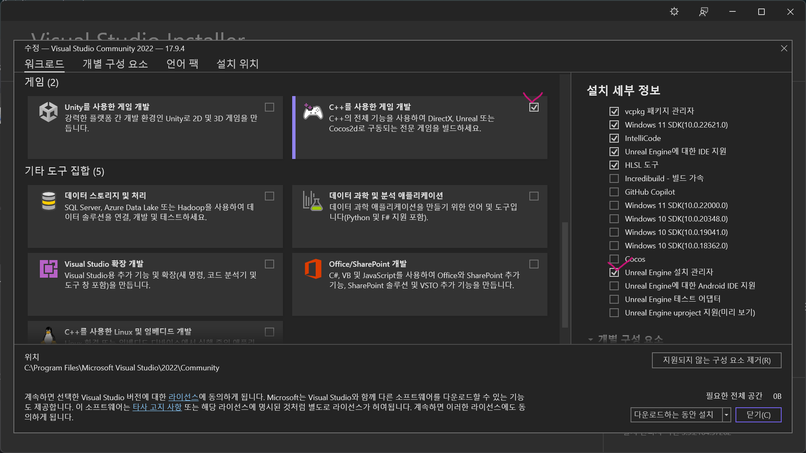
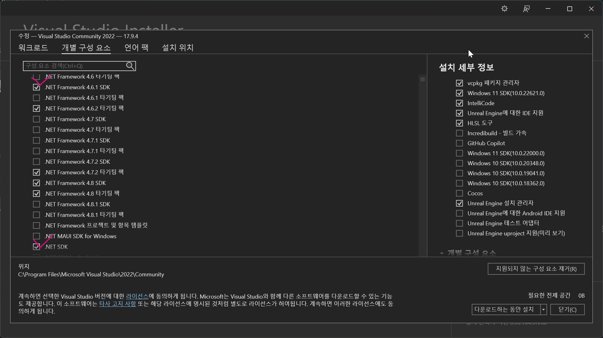
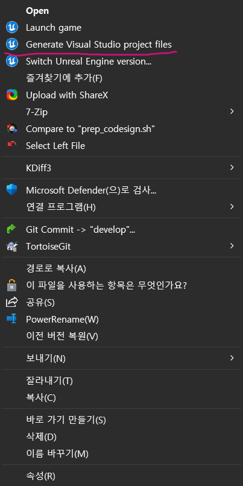

### The SDK 'Microsoft.NET.SDK.WorkloadAutoImportPropsLocator' specified could not be found. 오류

<details>
<summary>해결책</summary>

- **Visual Studio 2022 Install**
   
    
</details>


### Unable to build while Live Coding is active. Exit the editor and game, or press Ctrl+Alt+F11 if iterating on code in the editor or game

<details>
<summary>해결책</summary>

- 만약 다른 Unreal Proj이 열려있다면 닫는다.    
- 컴퓨터 재부팅    
- Unreal Project를 통해 Generate Visual Studio project files 실행
   - 

</details>

### 초기 실행시에 Class의 생성자에서 Crash가 발생하는경우
<details>
<summary>해결책</summary>

- UE는 초기 구동시에 각 Class들에 대해 ClassDefaultObject를 생성한다.
- 이 때 Module이 Load되어있지 않거나 여러 다른 이슈로인해 Crash가 발생할 수 있다.
- 아래의 코드를 통해 ClassDefaultObject의 Crash를 회피할 수 있다.

```C++
MyClass::MyClass()
{
	if(this->GetFlags() & RF_ClassDefaultObject)
	{
		return;
	}

   // ...
}
```

</details>